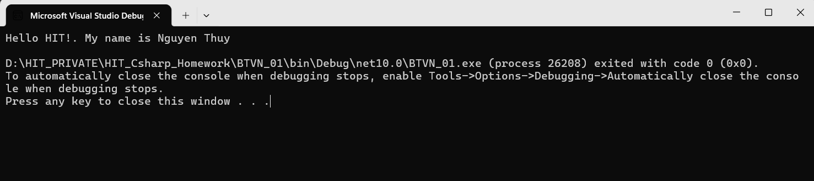
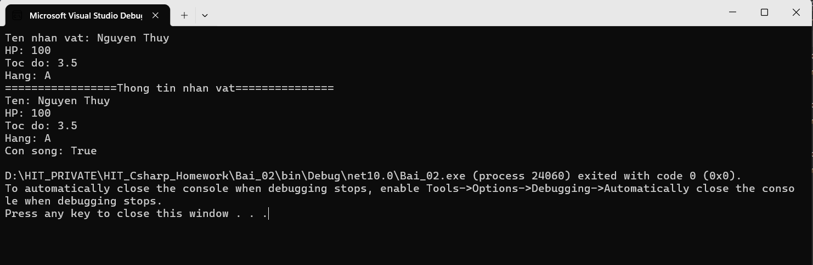
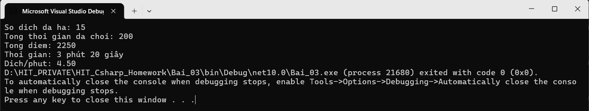

# HIT_Csharp_Homework
1. Họ và tên: Nguyễn Thị Thùy
2. Mục tiêu học C# và unity
   - Đạt điểm phát triển game 2D và 3D ở mức cao nhất có thể
   - Xa hơn thì xin phép private :)
3. Công cụ sẽ dùng
   - Git & GitHub
   - VS
   - ....

MINH CHỨNG BÀI TẬP VỀ NHÀ 1

